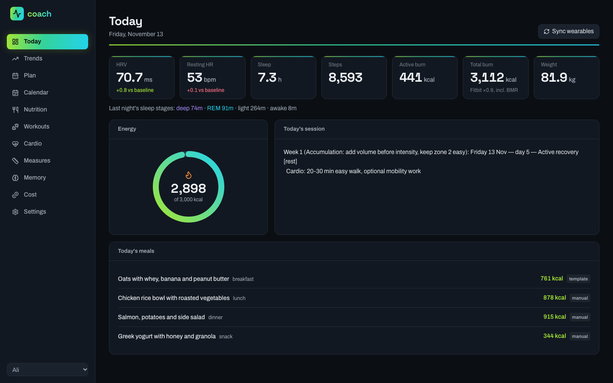
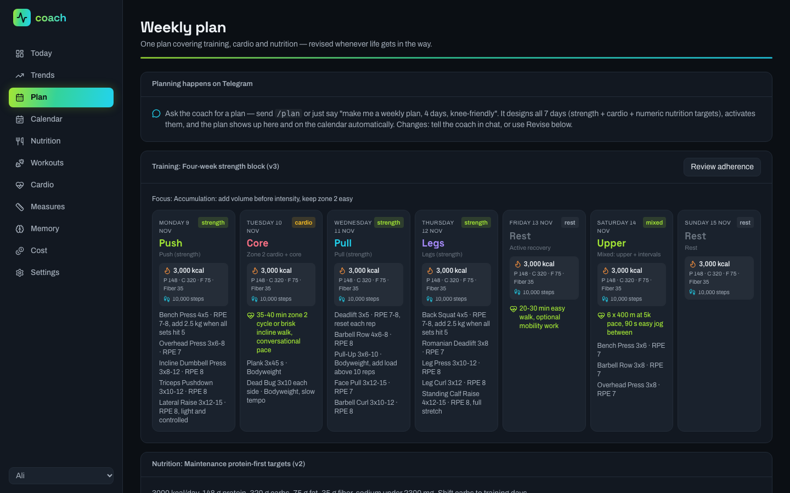
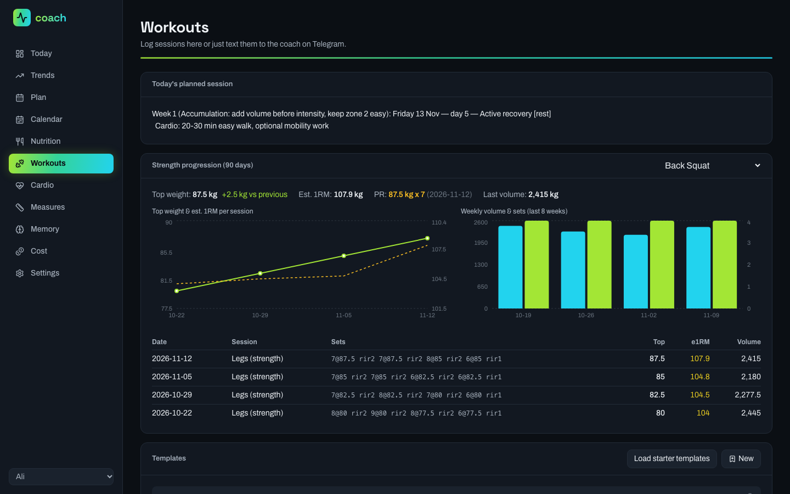
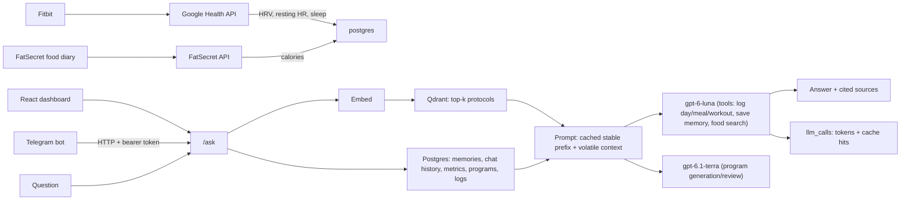

# AI Fitness Coach

[](https://github.com/suleymanbaran/ai-fitness-coach/actions/workflows/ci.yml)
[](https://www.python.org/)
[](LICENSE)

An AI fitness coach that turns your daily HRV, sleep and resting heart rate into concrete training
advice, grounded in vetted recovery and nutrition protocols and citing every source it uses. It
remembers your preferences across conversations, designs and reviews your training and nutrition
programs, logs meals and workouts from plain text, and runs ~$0.50-1.50/month on a two-tier OpenAI
model router with prompt caching.

**Stack:** Python, FastAPI, PostgreSQL (SQLAlchemy, Alembic), Qdrant, OpenAI Responses API
(`text-embedding-3-small`, `gpt-6-luna`, `gpt-6.1-terra`), React + TypeScript (Vite, Tailwind,
Recharts), python-telegram-bot, Streamlit (legacy), Docker, Caddy. Production serves the React
dashboard and API from the same HTTPS origin.

**By the numbers:** 139 tests green in CI with no API key (the LLM and embedder are faked) ·
retrieval MRR 0.94 on a 26-question labeled eval · ~$0.50-1.50/month per user via a two-tier model
router and 12h prompt caching · 14 Postgres tables, ~50 REST endpoints, 2 OAuth integrations
(Google Health, FatSecret) · one server-side conversation shared by the React dashboard and the
Telegram bot.







These screenshots are the demo profile created by `python -m scripts.seed --rich` — entirely
fictional data, generated relative to today's date so the dashboard is never empty. Google Health
is in Testing mode, so only Google accounts on the project's test-user list can connect a Fitbit.
Anyone can ask the coach questions and log days without connecting Google Health or FatSecret.

## What it does

- **Personal context:** compares today's metrics with your rolling 7-day baseline, computed in SQL
  with window functions, and puts the exact numbers in the prompt.
- **Grounded answers:** retrieves the most relevant protocols from a vector database and instructs
  the model to answer only from them, cite them by ID, and flag medical red flags.
- **Long-term memory:** durable preferences and facts ("no barbell squats — bad knee") are stored in
  Postgres, injected into every prompt, and distilled automatically from each conversation. You can
  browse, pin, edit and delete them in the UI or with `/memory` on Telegram.
- **Acts, not just answers:** during a chat the coach calls tools to log metrics, search the
  FatSecret food database, log meals (writing through to your real FatSecret diary when connected)
  and log completed workouts. When FatSecret's US-only free database misses a food (simit, döner,
  local Italian dishes), the coach falls back to OpenAI's built-in **web search** ($10/1k calls),
  and only then to its own estimate — always telling you which source the number came from.
- **Templates for the things you repeat:** save your usual breakfast as a *meal template* ("oats
  breakfast") and log it with one sentence or one click, optionally scaled ("1.5 servings").
  *Workout templates* (starter Push/Pull/Legs or your own) prefill the log form — with the weights
  from your last session, so progressive overload is one edit away. Fiber is tracked per meal,
  per template and per day alongside protein/carbs/fat. The web **Add meal** form only asks for
  food **names + grams** — kcal/macros are resolved automatically (`POST /users/{id}/meals/compute`:
  FatSecret per-100g hit first, otherwise one batched LLM estimate), and saved templates load into
  the same editable rows.
- **Programs, planned on Telegram:** the weekly plan (7 days of training incl. cardio + numeric
  nutrition targets) is created **from chat** — send `/plan` or just ask ("make me a weekly plan");
  the `create_weekly_plan` tool designs and activates both halves on the plan-tier model with
  schema-validated structured output, and they appear on the web Plan page and Calendar
  automatically. Nutrition plans are **numbers only** (kcal, protein, carbs, fat, fiber, sodium
  cap) — no menus unless you explicitly ask what to eat. Report adherence problems ("Fridays no
  longer work") in chat and the coach **revises and re-activates** the plan as a new version; old
  versions stay in history. Strength tracking: per-set weight/reps/RPE/**RIR**, Epley e1RM, weekly
  volume load, PRs — all queryable by the LLM (`strength_summary`) and charted in the dashboard.
- **Cardio capacity:** runs arrive three ways — automatically from Fitbit **exercise sessions** on
  every sync (running-family types at run pace; idempotent via the Google Health dataPoint name),
  from chat ("ran 5k in 27:30, heart rate 152" → `log_run`), or the Cardio page form. Pace and HR
  trends show aerobic progress (same pace at lower HR = fitter) with a Riegel 5k estimate per run,
  and the coach analyzes pace-vs-HR drift from the run history in its prompt.
- **Chat anywhere, one memory:** conversation history is server-side, so the web UI and the Telegram
  bot share the same conversation. The bot runs fully local via long polling — no public URL needed.
- **Wearable and nutrition sync:** connects Fitbit data through the Google Health API (OAuth 2.0) and
  the FatSecret food diary (OAuth 1.0), with encrypted tokens, automatic refresh, retries and idempotent upserts.
  Google Health only accepts accounts listed as test users while the app is unverified.
- **Budget by design:** two-tier model router (`gpt-6-luna` for chat at $0.10/M input,
  `gpt-6.1-terra` for program design) with explicit 12h prompt-cache breakpoints on the stable
  prefix (cached reads at $0.01/M). The Cost page shows real spend and cache-hit rate per call.
- **Measured retrieval:** a labeled question set scores search with hit rate, recall and MRR at k.
- **Production basics:** per-user token auth with object-level access checks, rate limiting on the
  LLM endpoint, upstream timeouts, request IDs in logs (no health data), Docker deployment behind HTTPS.
- **Runs offline:** demo mode and the test suite need no API key.

## How it works



## Design decisions

- **Two stores for two kinds of data.** Protocols are unstructured text, searched by meaning in Qdrant.
  Biometrics are exact numbers, queried in Postgres. Similarity search would blur the numbers.
- **RAG instead of fine-tuning.** Metrics change daily and advice must trace back to a source.
  Updating knowledge means re-embedding a document, not retraining a model.
- **Memory in Postgres, not a second vector DB.** One user accumulates tens of bounded preference
  rows, not millions of documents: they all fit in the prompt, so every relevant memory is *always*
  in context instead of relying on retrieval. A semantic memory collection stays an upgrade path.
- **Prompt layout is a caching decision.** The stable prefix (system rules, profile, memories, active
  program summary) changes at most daily and carries an explicit 12h cache breakpoint; volatile
  content (today's metrics, retrieved protocols, the question) comes last. OpenAI needs ≥1,024 cached
  tokens before a breakpoint pays for itself, so short prefixes skip it — writes cost 1.25x.
- **Two model tiers.** Routine chat/logging/extraction runs on `gpt-6-luna` (cheap, fast); program
  design and review runs on `gpt-6.1-terra` a few times a month. Extraction never overwrites a memory
  the user stated themselves (`source="user"` rows are SQL-guarded).
- **Programs are JSONB documents.** A plan is an LLM-generated artifact rendered by the UI and
  diffed against logs as a whole; normalizing sessions and exercises into tables would add joins
  without adding queries. One partial unique index enforces a single active program per kind.
- **The Telegram bot is a thin API client.** It calls the same REST endpoints with the same bearer
  token as the web UI, so auth, rate limits, history and memories behave identically on both, and
  the bot runs as an independent long-polling process (no public URL, no webhook).
- **Idempotent daily upserts.** One row per user per day with a unique constraint, so re-logging or a
  sync updates the day instead of duplicating it, and only overwrites the fields that were sent.
  Google and FatSecret can therefore fill the same day without erasing each other.
- **Evaluation before tuning.** Chunking and top-k stay unchanged until the eval says retrieval is weak.

## Results

Retrieval on 26 labeled questions over 12 protocols (`python -m scripts.eval_retrieval`):

| Embeddings | Hit rate @1 | Hit rate @3 | Recall @3 | MRR |
|---|---|---|---|---|
| OpenAI `text-embedding-3-small` | 0.88 | 1.00 | 0.99 | 0.94 |
| Word-hashing baseline (offline) | 0.38 | 0.81 | 0.78 | 0.57 |

Semantic embeddings find the right protocol for questions that share no keywords with it
(for example "almost passed out at rest" retrieves the medical red-flags protocol).
The knowledge base is small, so these numbers show the method works; they will drop as protocols grow.

## Project layout

| Path | Role |
|---|---|
| `data/protocols.json` | Unstructured knowledge, searched by meaning (vector DB) |
| `data/users.json` | Two demo profiles, loaded into Postgres by `scripts/seed.py`. `--rich` adds a month of meals, runs, workouts, body measures, programs, memories and token usage — every date generated relative to today, so the demo never goes stale. |
| `app/db/models.py` | 14 tables: `users`, `daily_biometrics`, `integration_accounts`, `user_memories`, `chat_messages`, `food_logs`, `body_measurements`, `meal_templates`, `workout_templates`, `session_adjustments`, `llm_calls`, `programs`, `workout_logs`, `run_logs` |
| `app/data_access/` | SQL layer: profiles with 7-day baselines, idempotent day upserts, memories, chat history, food logs, meal/workout templates, token usage |
| `app/rag/embeddings.py` | Text to vectors (OpenAI embeddings) |
| `app/rag/vector_store.py` | Qdrant collection: recreate, upsert, filtered search |
| `app/rag/prompt.py` | Prompt split into cached stable prefix and volatile context |
| `app/rag/generator.py` | `CoachClient`: Responses API, model router, prompt-cache breakpoints, tool loop |
| `app/rag/tools.py` | Function tools: log day/meal/workout, search food, save/forget memory, today's session |
| `app/rag/extraction.py` | Post-answer distillation of durable memories (structured output) |
| `app/rag/demo.py` | Offline stand-ins for OpenAI (demo mode and tests) |
| `app/main.py` | FastAPI app: `/ask`, users, days, messages, memories, meals, intake, usage |
| `app/programs/` | Program generation/activation/review, workout logs, their routes |
| `app/integrations/` | Google Health and FatSecret clients, OAuth flows, token encryption, sync |
| `app/telegram/` | Bot handlers + `CoachAPI` HTTP client (thin, stateless) |
| `web/` | React tracking dashboard (Vite + Tailwind + Recharts); `npm run dev` proxies to the API |
| `web/scripts/` | `verify-ui.mjs` headless-checks every page against the live API; `shoot-demo.mjs` regenerates the README screenshots from the demo profile and reports any page that rendered empty |
| `ui/streamlit_app.py` | Legacy Streamlit UI: metrics, charts, chat with server-side history |
| `ui/pages/` | Streamlit Training, Nutrition, Memory and Cost pages |
| `migrations/` | Alembic schema migrations |
| `scripts/ingest.py` | Embed protocols and load them into Qdrant |
| `scripts/telegram_bot.py` | Long-polling bot worker entry point |
| `scripts/cosine_playground.py` | Brute-force cosine search in NumPy |
| `tests/` | 139 pytest tests over 13 modules (API, auth, coach, food, memory, nutrition, programs, runs, measurements, templates, integrations, Telegram, evaluation). LLM and embedder are faked, Postgres is real, Qdrant runs in-memory — no API key needed. |
| `.github/workflows/ci.yml` | Runs the suite on every push and PR against a Postgres 16 service container |

## Run locally

One-time setup:

```bash
python -m venv .venv && source .venv/bin/activate
pip install -r requirements.txt
cp .env.example .env                # set OPENAI_API_KEY (or DEMO_MODE=true)
docker compose up -d                # Postgres on :5432, Qdrant on :6333
alembic upgrade head                # create the tables
python -m scripts.seed --rich       # optional: two demo profiles with a month of data
python -m scripts.ingest            # embed protocols into Qdrant (needs the OpenAI key)
```

Every time, in two (or three) terminals:

```bash
uvicorn app.main:app --reload       # terminal 1: the API, docs at http://127.0.0.1:8000/docs
cd web && npm run dev               # terminal 2: the React dashboard at http://localhost:5173
python -m scripts.telegram_bot      # terminal 3 (optional): the Telegram bot, see below
```

The dashboard (`web/`, Vite + React + Tailwind + Recharts, one-time `npm install`) is the main
tracking UI — dark theme with lime→cyan gradients (Archivo body, Space Grotesk numerals): Today
(gradient calorie ring, sleep stages, steps/burn), Trends (weight/HRV/sleep/intake charts), Plan
(weekly grid, revise box, version history — generation happens on Telegram), **Calendar** (month
view: planned day type vs. logged workouts/runs, kcal-vs-target colors and per-day step counts; clicking a day opens
its detail: planned session/focus/cardio, steps vs goal, taken-vs-target kcal/macros/fiber/sodium),
Nutrition (name+grams meal logging with auto-computed **and editable** macros, templates, numeric
targets only), Workouts
(per-exercise **weight progression**: top weight, e1RM, volume, set-by-set history), **Cardio**
(pace & HR trends, Riegel 5k estimate, run log), Measures, Memory, Cost (LLM spend + cache-hit
dashboard) and Settings (profile, provider connect/sync). Chat itself lives on Telegram. The dev
server proxies API paths to `:8000`, so no CORS setup is needed. The dev server listens on all
interfaces (`host: true`), so a phone on the same Wi-Fi can open `http://<mac-lan-ip>:5173`
(anywhere-else access: put the Mac on a free Tailscale tailnet and open the Tailscale IP). The
older Streamlit UI (`streamlit run ui/streamlit_app.py`) still works and keeps the chat page.

```bash
curl -X POST localhost:8000/ask -H 'Content-Type: application/json' \
  -d '{"user_id": "u1", "question": "My HRV dropped and my CNS feels fried. How should I adjust leg day?"}'
```

### Demo mode (no OpenAI key)

`DEMO_MODE=true uvicorn app.main:app --reload` skips `scripts.ingest`: protocols are embedded at
startup with a word-hashing stand-in, and the answer shows the prompt that would be sent to GPT.
Postgres still has to be running. Nothing is sent to OpenAI.

## Make it yours

In the UI sidebar, open **New profile** to create yourself. Then either connect Fitbit and FatSecret
(next section) or type a day under **Log a day** (HRV, sleep score, time asleep, resting HR, calories;
any subset). Re-logging a day only overwrites the fields you fill in.
The coach compares your latest day with the previous 7 days, and the UI warns when today is not logged yet.

Everything else happens in plain conversation, on the web or on Telegram — the coach has tools for it:

- "Slept 6h, HRV 52, log it" → writes today's `daily_biometrics`.
- "I had 2 eggs and a simit for breakfast" → searches FatSecret (or estimates when the food isn't in
  the US database), writes a `food_logs` entry, updates the day's calorie total, and mirrors the meal
  into your real FatSecret diary when connected.
- "Remember that I only have dumbbells at home" → stores a durable memory shown on the **Memory** page.
- "I did bench 5x5 at 80kg" → writes a `workout_logs` entry.

Training and nutrition programs are generated on the **Training** / **Nutrition** pages (or with
`/plan` on Telegram), reviewed against your adherence there, and the active program's summary is part
of the coach's cached context in every later conversation.

The same over HTTP:

```bash
curl -X PUT localhost:8000/users/me -H 'Content-Type: application/json' \
  -d '{"name": "Suleyman", "age": 30, "weight_kg": 78.5, "goal": "strength"}'
curl -X PUT localhost:8000/users/me/days/2026-10-10 -H 'Content-Type: application/json' \
  -d '{"hrv_ms": 58, "sleep_score": 71, "resting_hr_bpm": 56}'
```

## Connect your data (Google Health API and FatSecret)

Fitbit does not have its own API anymore. Its data is read through the
[Google Health API](https://developers.google.com/health), the successor of the Fitbit Web API.
Calories come from the [FatSecret Platform API](https://platform.fatsecret.com).
Typing a day still works, and a later sync only overwrites the fields that provider owns.
Google's total-calories value is stored unchanged; the coach and UI apply a 10% reduction (×0.9)
when calculating total burn. Because this adjustment is derived when displaying or using the data,
past records automatically use the new factor without rewriting historical or active-calorie values.

**Who can connect.** The Google Cloud app stays in Testing. Only Google accounts added under
**Google Auth Platform → Audience → Test users** can approve Fitbit access (up to 100 accounts).
Those health scopes stay limited to that list until Google verifies the app. A reviewer who is not
on the list uses the demo profile instead. FatSecret has no test-user list: whoever approves the
app on fatsecret.com can sync a diary, once the project's consumer key is configured.

| | Google Health API | FatSecret Platform API |
|---|---|---|
| What we use | `daily-heart-rate-variability` (RMSSD, ms), `daily-resting-heart-rate` (bpm), `sleep` (`minutesAsleep` of the main sleep), `weight` + `body-fat` (scale or manual weigh-ins) | `food_entries.get.v2` (diary, summed to kcal), `foods.search` v1 + `food.get` v6 (food lookup for the coach's tools), `food_entry.create` (coach-logged meals land in your real diary) |
| Where it lands | `hrv_ms`, `resting_hr_bpm`, `sleep_minutes`; `body_measurements` (a new weight also refreshes the profile) | `calories_kcal`, `food_logs` |
| Login | Google OAuth 2.0, read-only scopes, refresh token | 3-legged OAuth 1.0 (HMAC-SHA1). FatSecret's OAuth 2.0 cannot act for a user |
| Endpoint | `GET https://health.googleapis.com/v4/users/me/dataTypes/{type}/dataPoints` | `https://platform.fatsecret.com/rest/...` |
| Code | `app/integrations/google_health.py` | `app/integrations/fatsecret.py` |

Google has no Fitbit sleep *score*, so synced sleep is stored as hours asleep. A day with a nap and a
night's sleep keeps the session Google marks as the main sleep. A FatSecret day with no diary entries
is skipped, so "not logged" is never stored as 0 kcal.

Both logins are Fernet-encrypted in `integration_accounts` and never written to logs. Google access
tokens last about an hour and are refreshed automatically; if Google or FatSecret rejects the stored
login, sync reports it and the UI asks you to connect again.

**1. Encryption key.** Run `python -m scripts.generate_key` and put the output in `.env` as
`TOKEN_ENCRYPTION_KEY`. Losing this key means reconnecting both providers.

**2. Google Health.** In the [Google Cloud console](https://console.cloud.google.com), following
Google's [get started guide](https://developers.google.com/health):

1. Create a project and enable the **Google Health API** (APIs & Services, Library).
2. OAuth consent screen: user type External, app in Testing. Add the Google account your Fitbit is
   linked to as a test user. Add these scopes:
   - `https://www.googleapis.com/auth/googlehealth.health_metrics_and_measurements.readonly`
   - `https://www.googleapis.com/auth/googlehealth.sleep.readonly`
3. Create an OAuth client of type **Web application**. Google's form requires `https`, so start
   `python -m scripts.local_https` (it forwards `https://localhost:8443` to the API) and use this
   authorized redirect URI:
   `https://localhost:8443/integrations/google/callback`
   (in production: `https://<your-domain>/integrations/google/callback`).
   Set `PUBLIC_API_URL=https://localhost:8443` in `.env` so the app sends Google that same address.
   The certificate is self-signed; the first time the browser returns from Google, continue past the warning.
4. Put the client ID and secret in `.env` as `GOOGLE_CLIENT_ID` and `GOOGLE_CLIENT_SECRET`.

While the app stays in Testing, Google expires the refresh token after 7 days, so Connect has to be
pressed again weekly until the app is verified.

**3. FatSecret.** Register an app at [platform.fatsecret.com](https://platform.fatsecret.com) and copy
the OAuth 1.0 **Consumer Key** and **Consumer Secret** into `.env` as `FATSECRET_CONSUMER_KEY` and
`FATSECRET_CONSUMER_SECRET`. What the free **Basic** key gives you (verified against FatSecret's
edition table — diary reads/writes and food search are *not* Premier-only):

- 5,000 API calls/day, **US food database, English only**. Foods from other countries often aren't
  found by search; the coach then falls back to web search or estimates calories from general
  knowledge and logs them with `source="assistant"` (the diary sync still reports what you logged
  in the FatSecret app itself, which has the full local database).
- Food **search and nutrition lookup work with the consumer key alone** — you do not need to
  connect (OAuth) your diary for the coach to look foods up. Connecting only adds diary read and
  write-through of coach-logged meals.
- `foods.search` v6, autocomplete and barcode scanning are Premier. Students qualify for
  **Premier Free** (verification required); once granted, set `FATSECRET_PREMIER=true` and search
  upgrades to v6 with no code change.
- The app may only accept calls from IP addresses you allowlist in the FatSecret console.

The connect flow is FatSecret's [3-legged OAuth](https://platform.fatsecret.com/docs/guides/authentication/oauth1/three-legged):
request token, you approve on fatsecret.com, then the callback at
`/integrations/fatsecret/callback` exchanges it for a token that does not expire.

**4. Sync.** Restart the API so it reads the new `.env`. In the sidebar open **Connected apps**,
press Connect, approve access, then **Sync now** (last 14 days). Repeat syncs are safe.

```bash
python -m scripts.sync --user-id me --days 14     # same thing from the terminal
```

The production stack runs `scripts.sync` every 3 hours. `POST /users/{id}/sync?days=14` does one sync
over HTTP and returns, per provider, how many days changed or why it failed.

## Chat from Telegram

The bot is a separate long-polling process (`python -m scripts.telegram_bot`) that calls the same
REST API as the web UI with a normal bearer token — no webhook, no public URL, works fully local.
Conversation history lives in Postgres, so a question asked on Telegram shows up in the web chat and
the coach's memory is shared.

Setup (one time):

1. Create a bot with [@BotFather](https://t.me/BotFather) → `TELEGRAM_BOT_TOKEN`.
2. Get your numeric chat id (e.g. from [@userinfobot](https://t.me/userinfobot)) →
   `TELEGRAM_ALLOWED_CHAT_ID`. The bot refuses to start without it and serves *only* that chat;
   anyone else gets "Not authorized".
3. Issue an API token for the bound profile: `python -m scripts.issue_token me` → `TELEGRAM_API_TOKEN`,
   and set `TELEGRAM_BOUND_USER_ID=me` (default).

Then run `python -m scripts.telegram_bot` (locally) or enable the `bot` service in
`docker-compose.prod.yml`. On macOS you can install it as a launchd agent so it starts at login and
restarts on crashes: put a plist with `RunAtLoad`/`KeepAlive` running the command above (working
directory = repo root) in `~/Library/LaunchAgents/` and `launchctl bootstrap gui/$UID <plist>`.
Plain text goes to the coach (including logging via its tools); commands:
`/today`, `/meals`, `/workout`, `/plan` (no args: unified weekly plan — training+cardio+nutrition;
`/plan training|nutrition [brief]` for one), `/review [regenerate]`,
`/sync`, `/memory`, `/forget <kind> <key>`, `/start`.

## Models and costs

| Task | Model | Price per 1M tokens (in / cached / out) |
|---|---|---|
| Chat, tool calls, memory extraction | `gpt-6-luna` | $0.10 / $0.01 / $0.50 |
| Program generation and review | `gpt-6.1-terra` | $1.00 / $0.05 / $5.00 |
| Embeddings | `text-embedding-3-small` | $0.02 |
| Web search fallback (built-in tool) | — | $10 per 1,000 searches ($0.01 each) |

Prompt caching (OpenAI Responses API): the stable prefix — system rules, your profile, memories and
the active program summary — carries an explicit breakpoint with a 12h TTL (writes cost 1.25x, reads
0.1x), and the growing session is covered by an implicit 30m breakpoint. The prefix must reach
1,024 tokens before a breakpoint pays off, so short prefixes skip it. Every call is recorded in
`llm_calls` (model, purpose, input/cached/output tokens); the **Cost** page turns that into estimated
spend and cache-hit rate. At personal volume (dozens of questions a day) expect roughly
**$0.50-1.50/month**. Swap models via `FAST_MODEL` / `PLAN_MODEL` in `.env`.

Note: Gemini's free tier was evaluated and rejected for this use case — its free tier trains on your
content (health data) and gates context caching behind the paid tier.

## Check retrieval quality

`data/eval_questions.json` lists questions with the protocol IDs they should retrieve.

```bash
python -m scripts.eval_retrieval            # OpenAI embeddings (needs the key)
python -m scripts.eval_retrieval --demo     # offline hashing embedder, for comparison
```

It prints hit rate, recall and MRR at k = 1, 3, 5, plus every question missed at `RAG_TOP_K`.
Run it before and after changing protocols, chunking, top-k or the embedding model; change those
only when the score says retrieval is weak. Current scores are in [Results](#results).

## Going live (only when you need it off this machine)

`docker-compose.prod.yml` runs Postgres, Qdrant, the API, the UI and the Telegram bot on a private
network, with [Caddy](https://caddyserver.com) in front serving the UI over HTTPS. Only ports 80/443
are exposed; the bot talks to Telegram outbound via long polling and needs no port at all.
Each deploy runs `alembic upgrade head` and `scripts.ingest` before the API starts.

### AWS deployment

The repository does not contain Terraform, CloudFormation, ECS, RDS, or other AWS resource
definitions. The supported production deployment is the Docker Compose stack above, so on AWS it
must run on a Docker-capable host (for example, an EC2 instance) whose DNS name points to the
domain in `DOMAIN`. AWS resources, DNS records, storage, backups, and firewall rules remain
outside this repository.

Before starting the stack on the host:

1. Point the domain's DNS record at the host and allow inbound TCP ports 80 and 443 in its
   firewall/security group. Caddy uses port 80 for HTTP-to-HTTPS handling and certificate
   issuance, and port 443 for the dashboard and API.
2. Install Docker with Compose support, clone this repository, and keep the repository's
   `docker-compose.prod.yml` and `Caddyfile` together.
3. Use persistent host storage for Docker volumes (`postgres_data`, `qdrant_data`, `caddy_data`,
   and `caddy_config`) and configure backups separately if the deployment needs data recovery.

The production variables that must be supplied by the operator are `DOMAIN`,
`POSTGRES_PASSWORD`, and `OPENAI_API_KEY`. `TOKEN_ENCRYPTION_KEY` is required when Google Health
or FatSecret is enabled. Google/FatSecret credentials and the Telegram variables are optional
feature-specific settings; the complete template and defaults are in `.env.prod.example`.

Run the stack from the repository root:

```bash
cp .env.prod.example .env.prod      # set DOMAIN, POSTGRES_PASSWORD and OPENAI_API_KEY
docker compose -f docker-compose.prod.yml --env-file .env.prod up -d --build
docker compose -f docker-compose.prod.yml --env-file .env.prod exec api \
  python -m scripts.issue_token me --name "Suleyman"     # prints your access token once
```

The `setup` service applies migrations and ingests `data/protocols.json` before `api`, `sync`,
and `bot` start. Check it before diagnosing dependent services:

```bash
docker compose -f docker-compose.prod.yml --env-file .env.prod logs setup
docker compose -f docker-compose.prod.yml --env-file .env.prod ps
```

Open `https://<DOMAIN>` and sign in with the token. In production:

- Register `https://<DOMAIN>/integrations/google/callback` as the Google redirect URI, and put the
  same provider credentials plus `TOKEN_ENCRYPTION_KEY` in `.env.prod`. Caddy forwards only the
  `/integrations/*/callback` paths to the API; a `sync` service pulls the last 3 days every 3 hours.
- The `bot` service runs the Telegram worker against `http://api:8000` with `TELEGRAM_API_TOKEN`;
  it serves only `TELEGRAM_ALLOWED_CHAT_ID` and refuses to start without it.
- `AUTH_ENABLED=true`: every `/users` and `/ask` call needs `Authorization: Bearer <token>` and can
  only read or change the token owner's data (401 without a valid token, 403 for someone else's).
- `/ask` is limited to `ASK_RATE_LIMIT_PER_MINUTE` per user (429 with `Retry-After`).
- OpenAI calls time out after `OPENAI_TIMEOUT_SECONDS`; failures return 502 instead of crashing.
- Request logs hold method, path, status, duration and a request ID, never bodies or metric values.
- `scripts.seed` refuses to load demo users while `AUTH_ENABLED=true`.

You can turn auth on locally too (`AUTH_ENABLED=true` in `.env`); the UI then asks for a token.

## Test

```bash
docker compose up -d
python -m pytest -q
```

Tests use a separate `fitness_coach_test` database (created automatically, every test rolled back),
an in-memory Qdrant, and fake embedder, coach and provider APIs (`tests/fakes.py`, `app/rag/demo.py`,
`httpx.MockTransport`), so they need no API key and never call Google, FatSecret, Telegram or OpenAI.
Coverage spans the API and auth matrix, the CoachClient request/cache/tool-loop shape against a fake
Responses API, memory eviction and extraction guards, FatSecret search/diary-write signing and
parsing, program generation/retry/activation/adherence, and the Telegram layer (client, chunking,
authorization, handlers). Streamlit pages render headlessly via `streamlit.testing.v1.AppTest`.

CI (`.github/workflows/ci.yml`) runs this same suite on every push and pull request against a
Postgres 16 service container, and fails the run if any test was skipped — the suite skips itself
when Postgres is unreachable, and a green run that tested nothing is worse than a red one.
